# Architecture: modular blocks

```mermaid
flowchart LR
    D[("X, y")] --> V["Validation<br/>DecoyInputError"]
    V --> PP["Preprocessing (train only)<br/>impute, drop constants,<br/>Yeo-Johnson, robust scale"]
    PP --> C
    subgraph C["Decoys (selectable)"]
        direction TB
        R["Random probes"]
        S["Shadow copies"]
        B["Block-Shadow (optional)"]
    end
    C --> K
    subgraph K["Rankers (add / remove)"]
        direction TB
        K1["ANOVA"]; K2["chi2"]; K3["MI"]; K4["ReliefF"]
        K5["RF"]; K6["XGB gain"]; K7["L1-LR"]; K8["your ranker"]
    end
    K --> F["Flags per ranker<br/>beat Random max AND<br/>Shadow (1-alpha) quantile"]
    F --> PO["Policy (swappable)<br/>all / majority / any / int / callable"]
    PO --> ST["Stability filter<br/>(optional)"]
    ST --> O["Subset + report_<br/>audit trail"]
    O --> E["Evaluation<br/>compare_selectors"]
    CMP["Comparators<br/>Fixed-k, CV-k 1-SE,<br/>Boruta-style, NABFS"] --> E
```

| Block | Module | How to change it |
|---|---|---|
| Validation | `decoyfs.validation` | fixed contract (see README) |
| Preprocessing | `decoyfs.preprocessing` | fitted on training data only |
| Decoys | `decoyfs.controls`, `decoyfs.dependence` | `DecoySelector(controls=...)` |
| Rankers | `decoyfs.rankers` | `register_ranker`, `DecoySelector(rankers=...)` |
| Policy | `decoyfs.policies` | `register_policy`, `DecoySelector(policy=...)` |
| Comparators | `decoyfs.selectors`, `decoyfs.comparators` | `FixedKSelector`, `CVKSelector`, `BorutaSelector`, `NABFSSelector` |
| Evaluation | `decoyfs.compare` | `compare_selectors` |
| Benchmark | `decoyfs.bench` | paper harness (extra `bench`) |

## What a fit does

1. Validate `X`, `y`; fit the preprocessing on the training data; drop constant columns.
2. Append decoys: Random probes (≥ 14, ≥ 5 % of p, multiple of 7) and Shadow copies of every column.
3. Score real features and decoys with every ranker (GPU when available).
4. A ranker *votes* for a feature if the feature beats the highest Random score **and** the `1 - alpha` quantile of the Shadow scores.
5. The policy maps votes to the subset. Optionally, keep only features selected in ≥ `stability_pi` of `stability_B` subsamples.
6. Store `report_`, `decoy_thresholds_`, `null_pass_rate_` and `fdp_estimate_`.

## Guarantees and limits

* The Random/Shadow comparison calibrates *noise level*, not a formal false-discovery rate. `null_pass_rate_` is an empirical proxy, and `fdp_estimate_` rescales it as a target-decoy estimate (`min(1, FPR·(p − |S|)/|S|)`); it has no coverage guarantee.
* Shadow features break dependence between columns; with strongly correlated groups use `controls=("random", "block")`.
* Classification only; numeric features only.
